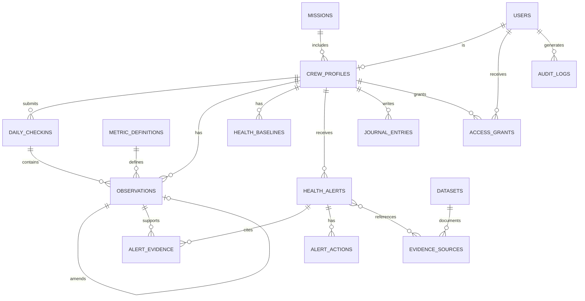

# AstraPulse — Data Dictionary

Version 1.0 · Database: PostgreSQL 16 · Migrations: Alembic
Conventions: `snake_case`; primary keys are UUID (`uuid_generate_v4()` / `gen_random_uuid()`); timestamps are `timestamptz` in UTC; all tables have `created_at`.

---

## 1. Entity overview



> **Design note:** The blueprint's separate `vital_readings` and `radiation_readings` tables are unified into `observations` (see TECH_STACK ADR-1). Vitals and radiation are distinguished by `metric_definitions.category`.

---

## 2. Enumerated types

| Enum | Values |
|---|---|
| `user_role` | `astronaut`, `specialist`, `admin` |
| `data_source` | `manual`, `simulated`, `imported_file`, `imported_nasa`, `device` |
| `observation_status` | `valid`, `missing`, `rejected` |
| `metric_category` | `cardiovascular`, `physiology`, `sleep`, `wellness`, `activity`, `environment`, `lab` |
| `direction` | `high`, `low`, `both` |
| `alert_level` | `info`, `watch`, `review_required` |
| `alert_status` | `open`, `reviewed`, `resolved_auto`, `dismissed` |
| `action_type` | `reviewed`, `comment`, `follow_up_observation`, `escalated_per_protocol` |
| `visibility` | `private`, `shared` |
| `sync_result` | `accepted`, `duplicate`, `rejected` |

---

## 3. Tables

### 3.1 `users`
| Column | Type | Notes |
|---|---|---|
| id | uuid PK | |
| email | citext UNIQUE NOT NULL | |
| password_hash | text NOT NULL | Argon2id |
| role | user_role NOT NULL | |
| is_active | boolean NOT NULL default true | |
| failed_logins | int NOT NULL default 0 | back-off |
| locked_until | timestamptz NULL | |
| created_at | timestamptz NOT NULL | |

### 3.2 `missions`
| Column | Type | Notes |
|---|---|---|
| id | uuid PK | |
| code | text UNIQUE NOT NULL | e.g., `ARES-01` |
| name | text NOT NULL | |
| is_simulated | boolean NOT NULL default true | drives UI banner |
| start_date | date NOT NULL | mission day = date − start_date + 1 |
| description | text | |

### 3.3 `crew_profiles`
| Column | Type | Notes |
|---|---|---|
| id | uuid PK | |
| user_id | uuid FK→users UNIQUE | |
| mission_id | uuid FK→missions | |
| crew_code | text UNIQUE NOT NULL | e.g., `ASTRA-001` (pseudonymous) |
| display_name | text | fictional in demo |
| scenario | text NULL | seed scenario label |

### 3.4 `metric_definitions`
| Column | Type | Notes |
|---|---|---|
| code | text PK | e.g., `resting_hr_bpm` |
| label | text NOT NULL | |
| unit | text NOT NULL | canonical unit |
| category | metric_category NOT NULL | |
| plausible_min | numeric NOT NULL | data-entry sanity bound |
| plausible_max | numeric NOT NULL | |
| direction | direction NOT NULL | default adverse direction |
| zero_allowed | boolean NOT NULL | false for HR, SpO₂, temp, etc. |
| is_scale | boolean NOT NULL | 1–5 self-report scales |
| description | text | |

Seed list: `resting_hr_bpm`, `bp_systolic_mmhg`, `bp_diastolic_mmhg`, `spo2_pct`, `body_temp_c`, `respiratory_rate_bpm`, `sleep_hours`, `sleep_quality`, `mood`, `fatigue`, `stress`, `exercise_minutes`, `resistive_exercise_minutes`, `radiation_dose_rate_usv_h` (+ optional `wbc_10e9_l`, `lymphocyte_pct` in category `lab`).

### 3.5 `daily_checkins`
| Column | Type | Notes |
|---|---|---|
| id | uuid PK | |
| crew_id | uuid FK→crew_profiles NOT NULL | |
| client_id | uuid NOT NULL | generated on the client; idempotency |
| observed_on | date NOT NULL | the day the check-in describes |
| symptoms | text[] NOT NULL default '{}' | controlled vocabulary |
| note | text NULL | non-journal short note |
| data_source | data_source NOT NULL | |
| recorded_at | timestamptz NOT NULL | server receive time |
| client_created_at | timestamptz NULL | when entered on device (offline) |
| UNIQUE | (crew_id, client_id) | duplicates return original |

### 3.6 `observations` — **core table**
| Column | Type | Notes |
|---|---|---|
| id | uuid PK | |
| crew_id | uuid FK NOT NULL | |
| checkin_id | uuid FK→daily_checkins NULL | null for imports/device |
| metric_code | text FK→metric_definitions NOT NULL | |
| value | numeric **NULL** | NULL when missing/rejected |
| unit | text NOT NULL | canonical unit |
| raw_value | numeric NULL | as entered/imported |
| raw_unit | text NULL | |
| observed_at | timestamptz NOT NULL | when the measurement applies |
| recorded_at | timestamptz NOT NULL | when stored |
| data_source | data_source NOT NULL | **required** |
| source_ref | text NULL | file name, dataset accession, device ID |
| status | observation_status NOT NULL | |
| reject_reason | text NULL | required when `rejected` |
| client_id | uuid NOT NULL | idempotency per observation |
| amends_id | uuid FK→observations NULL | amendment chain |
| UNIQUE | (crew_id, client_id) | |
| CHECK | `(status = 'valid') = (value IS NOT NULL)` | missing/rejected ⇒ NULL value; valid ⇒ value present |
| CHECK | `status <> 'rejected' OR reject_reason IS NOT NULL` | |
| INDEX | (crew_id, metric_code, observed_at DESC) | analytics queries |

**Immutability:** no `UPDATE`/`DELETE` privileges for the application role on this table (enforced by DB grants and by a trigger that raises on update/delete in tests/dev).

### 3.7 `health_baselines`
| Column | Type | Notes |
|---|---|---|
| id | uuid PK | |
| crew_id | uuid FK | |
| metric_code | text FK | |
| computed_at | timestamptz | `as_of` |
| window_start / window_end | timestamptz | |
| median | numeric NOT NULL | |
| scale | numeric NOT NULL | σ-equivalent |
| scale_method | text NOT NULL | `mad`/`iqr`/`floor` |
| n_observations | int NOT NULL | |
| state | text NOT NULL | `insufficient_data`/`baseline_forming`/`ready` |
| ruleset_version | text NOT NULL | |

Baselines are **derived and reproducible**; they can be recomputed from observations at any time.

### 3.8 `health_alerts`
| Column | Type | Notes |
|---|---|---|
| id | uuid PK | |
| crew_id | uuid FK | |
| rule_id | text NOT NULL | e.g., `R-COMBINED` |
| level | alert_level NOT NULL | |
| status | alert_status NOT NULL default 'open' | |
| window_start / window_end | timestamptz NOT NULL | |
| metrics | text[] NOT NULL | metrics involved |
| summary | text NOT NULL | deterministic explanation |
| explanation | jsonb NOT NULL | structured: baseline, latest, deviation, persistence, trend |
| suggested_followup | text NOT NULL | from protocol library |
| protocol_ref | text NULL | |
| ruleset_version | text NOT NULL | |
| data_sources | data_source[] NOT NULL | source mix at generation |
| created_at / resolved_at | timestamptz | |
| UNIQUE | (crew_id, rule_id, window_end) | idempotent generation |

### 3.9 `alert_evidence`
| Column | Type | Notes |
|---|---|---|
| alert_id | uuid FK | |
| observation_id | uuid FK | |
| role | text | `baseline`, `recent`, `latest` |
| PK | (alert_id, observation_id) | |

### 3.10 `alert_actions`
| Column | Type | Notes |
|---|---|---|
| id | uuid PK | |
| alert_id | uuid FK | |
| actor_user_id | uuid FK→users | |
| action_type | action_type NOT NULL | |
| comment | text NULL | |
| follow_up_checkin_id | uuid FK NULL | links follow-up observation |
| created_at | timestamptz | append-only |

### 3.11 `journal_entries`
| Column | Type | Notes |
|---|---|---|
| id | uuid PK | |
| crew_id | uuid FK | |
| entry_date | date NOT NULL | |
| body | text NOT NULL | **never** logged, analysed, or sent to third parties |
| visibility | visibility NOT NULL default 'private' | |
| client_id | uuid NOT NULL | idempotency |
| created_at / updated_at | timestamptz | journal edits allowed (personal writing), audited |

### 3.12 `access_grants`
| Column | Type | Notes |
|---|---|---|
| id | uuid PK | |
| crew_id | uuid FK | data owner |
| grantee_user_id | uuid FK→users | specialist |
| scope | text[] NOT NULL | e.g., `{observations,alerts,journal_shared}` |
| valid_from / valid_until | timestamptz | |
| revoked_at | timestamptz NULL | |
| created_by | uuid FK | |

Access rule: a specialist may read crew data only if an unexpired, unrevoked grant covers the scope. Journal entries additionally require `visibility = 'shared'`.

### 3.13 `evidence_sources`
| Column | Type | Notes |
|---|---|---|
| id | uuid PK | |
| title | text NOT NULL | |
| publisher | text NOT NULL | e.g., NASA HRP |
| url | text NOT NULL | |
| accessed_on | date NOT NULL | |
| supports | text NOT NULL | what claim it supports |
| metric_codes | text[] | linked metrics |
| dataset_id | uuid FK NULL | |
| kind | text | `risk_page`, `dataset`, `paper`, `standard` |

### 3.14 `datasets` (NASA dataset registry)
| Column | Type | Notes |
|---|---|---|
| id | uuid PK | |
| accession | text UNIQUE | e.g., OSDR study ID |
| title | text | |
| source_url | text | |
| variables | jsonb | name, unit, description |
| subjects | text | species/population description |
| mission_context | text | |
| access_level | text | `public`, `controlled`, `unknown` |
| limitations | text NOT NULL | required |
| inspected_on | date NOT NULL | must be inspected before use |
| used_in_app | boolean default false | |

### 3.15 `rulesets`
| Column | Type | Notes |
|---|---|---|
| version | text PK | `demo_v1` |
| content_hash | text NOT NULL | SHA-256 of YAML |
| description | text | |
| activated_at | timestamptz | |

### 3.16 `sync_batches`
| Column | Type | Notes |
|---|---|---|
| id | uuid PK | |
| user_id | uuid FK | |
| received_at | timestamptz | |
| item_count | int | |
| accepted / duplicate / rejected | int | |
| details | jsonb | per-item results (no health values) |

### 3.17 `audit_logs`
| Column | Type | Notes |
|---|---|---|
| id | bigserial PK | |
| at | timestamptz NOT NULL | |
| actor_user_id | uuid NULL | |
| action | text NOT NULL | `login`, `read_crew_data`, `grant_create`, `export`, `alert_review`, … |
| target_type / target_id | text / uuid | |
| ip_hash | text | hashed |
| metadata | jsonb | **no health values** |

Insert-only for the app role.

---

## 4. Provenance rules (enforced in code and tests)

1. `data_source` is NOT NULL on `daily_checkins` and `observations`.
2. Simulated rows come only from the seed/generator and carry `source_ref = 'scenario:<name>@seed:<n>'`.
3. `imported_nasa` rows require `source_ref` = dataset accession and a `datasets` row.
4. Reports and API summaries include the distinct `data_source` set.
5. The UI shows a banner if any displayed observation or alert is `simulated`.

## 5. Missing-data rules

| Situation | Stored as |
|---|---|
| Field left blank in check-in | `status = missing`, `value = NULL` |
| Implausible entry | `status = rejected`, `value = NULL`, reason stored, raw kept |
| Genuine zero (e.g., 0 min exercise) | `status = valid`, `value = 0` (only if `zero_allowed`) |

## 6. Controlled symptom vocabulary (initial)
`headache`, `nausea`, `dizziness`, `muscle_ache`, `joint_discomfort`, `back_discomfort`, `eye_strain`, `congestion`, `skin_irritation`, `digestive_discomfort`, `low_motivation`, `difficulty_concentrating`, `irritability`, `other`. Symptoms are **self-reported labels**, never interpreted as diagnoses.

## 7. Example payload

```json
{
  "client_id": "7b3f1c0e-3c0f-4a53-9d1f-0b8e9f2e5a11",
  "observed_on": "2026-11-14",
  "data_source": "simulated",
  "observations": [
    {"client_id": "…", "metric_code": "resting_hr_bpm", "value": 76, "unit": "bpm"},
    {"client_id": "…", "metric_code": "sleep_hours",    "value": 7.2, "unit": "h"},
    {"client_id": "…", "metric_code": "mood",           "value": null}
  ],
  "symptoms": [],
  "note": null
}
```
`mood: null` is stored as `status = missing`, not as zero.

## 8. Retention and deletion
Demo data is disposable. For any real-world deployment: documented retention periods, user-initiated export, and deletion of personal journal entries on request (observations remain append-only, subject to policy).
