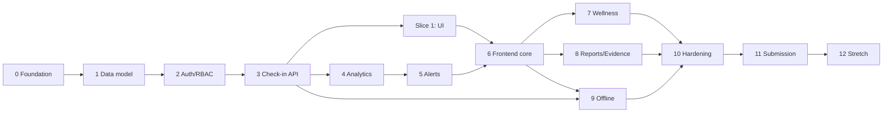

# AstraPulse — Phased Implementation Roadmap

Version 1.0 · Team Interstellar · Companion to [PRD.md](PRD.md) and [TECH_STACK.md](TECH_STACK.md)

This roadmap is ordered by **dependency and value**, not by calendar dates. Effort sizes: **S** (hours), **M** (about a day), **L** (multiple days).

**How to use it:** work phase by phase. Do not start a phase until the previous exit criteria are met. After Phase 3, build a *vertical slice* before going deeper.

---

## Milestones

| Milestone | Reached after | What exists |
|---|---|---|
| **M1 — Walking skeleton** | Phase 3 + Slice 1 | Login → check-in → stored → shown on dashboard |
| **M2 — Intelligent MVP** | Phase 6 | Baselines, trends, explainable alerts, review workflow |
| **M3 — Mission-complete** | Phase 9 | Wellness privacy, reports, evidence, offline sync |
| **M4 — Submission-ready** | Phase 11 | Hardened, deployed, documented, demo recorded |
| **M5 — Stretch** | Phase 12 | ML experiment, Explain, specialist console, blackout simulator |

**MVP cut line:** M2 + CSV report + offline check-in. Everything beyond is differentiation.

---

## Phase 0 — Foundation ✅ (Stage 1 guide)
**Goal:** Repo, Postgres, FastAPI, React shell, CI.
**Exit:** Stage 1 acceptance checklist passes; CI green.

---

## Phase 1 — Domain model and data foundation
**Goal:** Database schema that enforces provenance and privacy.
**Depends on:** Phase 0 · **Spec:** [DATA_DICTIONARY.md](DATA_DICTIONARY.md)

| ID | Task | Size |
|---|---|---|
| 1.1 | SQLAlchemy models for all tables in the data dictionary | M |
| 1.2 | Alembic initial migration + enum types + constraints | M |
| 1.3 | `metric_definitions` seed (codes, units, plausibility bounds, direction) | S |
| 1.4 | Repository layer with typed methods | M |
| 1.5 | Synthetic data generator (`scripts/seed.py`), fixed seed, four ARES-01 scenarios | L |
| 1.6 | Model tests: constraints, provenance NOT NULL, append-only guard | M |

**Deliverables:** migrations, seed script, ERD image in docs.
**Exit:** `alembic upgrade head` + `seed --reset` produce identical data twice; constraint tests pass.

**Kickoff prompt:** *"Implement Phase 1 of docs/ROADMAP.md using docs/DATA_DICTIONARY.md. Tests first. Follow CLAUDE.md."*

---

## Phase 2 — Authentication, RBAC, audit
**Depends on:** Phase 1 · **Spec:** [TECH_STACK.md](TECH_STACK.md) §4.3, [API_SPEC.md](API_SPEC.md)

| ID | Task | Size |
|---|---|---|
| 2.1 | Argon2id hashing, login, refresh rotation, logout | M |
| 2.2 | Role dependencies (`require_role`) and ownership/grant checks | M |
| 2.3 | Login rate limiting + back-off | S |
| 2.4 | Audit log service (insert-only) + events list | M |
| 2.5 | Authz test matrix (401/403/ownership) for all existing routes | M |

**Exit:** authz matrix tests green; no endpoint reachable without auth except health/login.

---

## Phase 3 — Check-ins and observations API
**Depends on:** Phase 2 · **Spec:** PRD §7.3, API_SPEC

| ID | Task | Size |
|---|---|---|
| 3.1 | Plausibility validation (bounds from `metric_definitions`) | M |
| 3.2 | `POST /checkins` with idempotency key, nullable fields → `missing` | M |
| 3.3 | `GET /checkins`, `GET /observations` with filters and pagination | M |
| 3.4 | Amendment endpoint (`POST /observations/{id}/amend`) | S |
| 3.5 | CSV/JSON import with validation report and provenance label | L |
| 3.6 | Tests: missing≠zero, duplicates, bounds, ownership | M |

**Exit:** a check-in with skipped fields stores NULL values, never zeros; duplicate key returns the original response.

### ▶ Vertical Slice 1 — "First check-in on screen"
Build the minimal UI for login → check-in form → dashboard metric cards (with source badge, timestamp, "Not recorded") using real API data.
**Exit (M1):** submit a check-in in the browser, restart the server, data still there.

---

## Phase 4 — Analytics engine
**Depends on:** Phase 3 · **Spec:** [ANALYTICS_SPEC.md](ANALYTICS_SPEC.md)

| ID | Task | Size |
|---|---|---|
| 4.1 | `validation.py`: de-duplication, unit normalisation, plausibility | M |
| 4.2 | `baseline.py`: median, MAD/IQR/floor scale, sufficiency states | M |
| 4.3 | `deviation.py`: modified z-score, direction awareness | M |
| 4.4 | `trends.py`: Theil–Sen slope, rolling median | M |
| 4.5 | `rules.py`: persistence, single-reading, combined-pattern rules from YAML | L |
| 4.6 | `explain.py`: deterministic explanation templates + evidence IDs | M |
| 4.7 | `rulesets/demo_v1.yaml` with "demonstration parameters" header | S |
| 4.8 | Unit, property (Hypothesis), and golden scenario tests | L |
| 4.9 | Analytics API: `/analytics/summary`, `/baseline`, `/trends` | M |

**Exit:** ASTRA-001 yields no `review_required`; ASTRA-002 yields a sleep/fatigue/HR combined pattern; MAD = 0 never causes division errors; analytics coverage ≥ 90 %.

---

## Phase 5 — Alerts and decision support
**Depends on:** Phase 4 · **Spec:** PRD §7.5

| ID | Task | Size |
|---|---|---|
| 5.1 | Alert persistence, idempotency `(crew_id, rule_id, window_end)` | M |
| 5.2 | Evidence linking `alert_evidence` → observations | S |
| 5.3 | Protocol library (placeholder, labelled) + suggested follow-up mapping | M |
| 5.4 | Actions API: review, comment, follow-up observation | M |
| 5.5 | Alert timeline (history, outcomes) | M |
| 5.6 | Copy-safety test: denylist scan of all generated strings | S |

**Exit:** re-running analytics creates no duplicate alerts; every alert has rule ID, ruleset version, and ≥ 1 evidence row.

---

## Phase 6 — Frontend: design system and core screens
**Depends on:** Phases 3–5 (can overlap with 5 after contracts freeze) · **Spec:** TECH_STACK §6

| ID | Task | Size |
|---|---|---|
| 6.1 | Design system: tokens, `MetricCard`, `ProvenanceBadge`, `SimulatedBanner`, `NotRecorded` | M |
| 6.2 | Dashboard (cards, trend charts with baseline band, alerts panel, status) | L |
| 6.3 | Daily Check-in form (React Hook Form + Zod, all fields optional) | M |
| 6.4 | Health Analytics page (baseline details, deviation chart, data table alternative) | L |
| 6.5 | Alert Center + Alert detail (what/why/baseline/latest/follow-up/evidence) | L |
| 6.6 | Settings & Profile, mission info | S |
| 6.7 | Accessibility pass (axe, keyboard, contrast) | M |

**Exit (M2):** full path — check-in → alert appears → review with comment → follow-up recorded — works in the browser against seeded data.

---

## Phase 7 — Behavioural wellness and privacy
**Depends on:** Phase 6 · **Spec:** PRD §7.6, SAFETY doc

| ID | Task | Size |
|---|---|---|
| 7.1 | Wellness page: sleep/mood/fatigue/stress trends | M |
| 7.2 | Private journal CRUD (default `private`) | M |
| 7.3 | Consent grants (create, revoke, expiry) + audit | M |
| 7.4 | Specialist access scoping tests (journal exclusion) | M |
| 7.5 | Supportive-copy review against safety rules | S |

**Exit:** a specialist account cannot read an unshared journal entry through any endpoint (test proves it).

---

## Phase 8 — Reports, evidence, and NASA data
**Depends on:** Phase 6 · **Spec:** PRD §7.7–7.8

| ID | Task | Size |
|---|---|---|
| 8.1 | CSV export of observations + alerts | S |
| 8.2 | PDF report (ReportLab): summary, charts, alerts, follow-ups, completeness, provenance, disclaimer | L |
| 8.3 | Evidence library + metric/alert linking | M |
| 8.4 | NASA dataset registry: inspect candidate OSDR studies, record variables/units/access limits | L |
| 8.5 | Optional import of a verified public NASA dataset as `imported_nasa` context | L |
| 8.6 | Radiation context panel (simulated dose rate; real NASA/NOAA context only if verified) | M |

**Exit:** PDF shows source mix, ruleset version, disclaimer; every registry entry lists limitations; real vs simulated visually distinct.

---

## Phase 9 — Offline-first PWA and sync
**Depends on:** Phases 3 & 6 · **Spec:** TECH_STACK §7

| ID | Task | Size |
|---|---|---|
| 9.1 | PWA manifest, service worker, app-shell caching | M |
| 9.2 | Dexie schema: outbox, cached observations/alerts | M |
| 9.3 | Offline check-in → pending state in UI | M |
| 9.4 | `POST /sync` batch endpoint with per-item results | M |
| 9.5 | Sync engine: retry/back-off, ordering, crash recovery | L |
| 9.6 | Blackout simulator toggle for demos | S |
| 9.7 | Playwright offline tests (offline submit, reconnect, duplicate, mid-sync close) | L |

**Exit (M3):** 0 lost / 0 duplicated records across all offline test scenarios.

---

## Phase 10 — Hardening and deployment
**Depends on:** all above

| ID | Task | Size |
|---|---|---|
| 10.1 | Security review against checklist (headers, CORS, rate limits, secrets, audit) | M |
| 10.2 | Dependency audit (`pip-audit`, `npm audit`) and fixes | S |
| 10.3 | Performance budget check (Lighthouse, API latency) | M |
| 10.4 | Full e2e suite + accessibility suite in CI | M |
| 10.5 | Dockerfiles; compose for full stack | M |
| 10.6 | Deploy: Postgres, API, frontend; seed demo; smoke tests | M |
| 10.7 | Backup of seed + reset script; runbook | S |

**Exit:** all release gates in [TEST_PLAN.md](TEST_PLAN.md) §9 green on the deployed URL.

---

## Phase 11 — Submission package
**Depends on:** Phase 10 · **Spec:** [SUBMISSION.md](SUBMISSION.md)

| ID | Task | Size |
|---|---|---|
| 11.1 | Finalise README, architecture diagram, screenshots | M |
| 11.2 | Re-write abstract/description to match what is *actually built* | S |
| 11.3 | Build the deck (12 slides) | M |
| 11.4 | Record demo video; keep a rehearsed live fallback | M |
| 11.5 | Claims audit: every statement sourced or labelled as design choice | S |
| 11.6 | Submit via official form; save confirmation | S |

**Exit (M4):** submission confirmation saved; repo public with licence and no secrets.

---

## Phase 12 — Stretch (only after M4)
| ID | Task | Pri |
|---|---|---|
| 12.1 | Isolation Forest experiment, shown separately with caveats | P3 |
| 12.2 | AstraPulse Explain (grounded LLM rewrite with denylist validation) | P3 |
| 12.3 | Specialist console (crew roster, alert queue, evidence panel) | P2 |
| 12.4 | Communication-delay simulator (Earth–Mars light-time and blackout windows) | P2 |
| 12.5 | Radiation-event overlay on trends (verified public space-weather data) | P3 |
| 12.6 | Internationalisation (English first; structure for more) | P3 |

---

## Dependency map



---

## Risk register

| Risk | Likelihood | Impact | Mitigation | Owner |
|---|---|---|---|---|
| Scope creep | High | High | Priority tiers; M2 cut line | Lead |
| Analytics edge cases (MAD=0, sparse data) | Medium | High | Property tests; sufficiency states | Analytics |
| Offline sync duplicates | Medium | High | Idempotency keys; Playwright tests | Frontend/Backend |
| NASA dataset unsuitable | Medium | Medium | Registry; use as context only | Research |
| Deploy/network failure at demo | Medium | High | Recorded demo + local fallback | Lead |
| Overclaiming in deck | Medium | High | Claims audit (11.5) | Presenter |
| Team availability | Medium | Medium | Vertical slices; clear ownership | Lead |

---

## Suggested ownership (adjust to your team)
| Area | Owner |
|---|---|
| Backend, DB, auth | Dev A |
| Analytics engine + tests | Dev B |
| Frontend, design system | Dev C |
| Research, evidence, safety copy, deck | Dev D / Presenter |

---

## Phase checklist template
```
Phase N — <name>
[ ] Spec section read
[ ] Tests written first
[ ] Implementation complete
[ ] Lint / types / tests green
[ ] Docs updated (spec, data dictionary, API)
[ ] Exit criteria demonstrated
[ ] Demo-able in the running app
```
