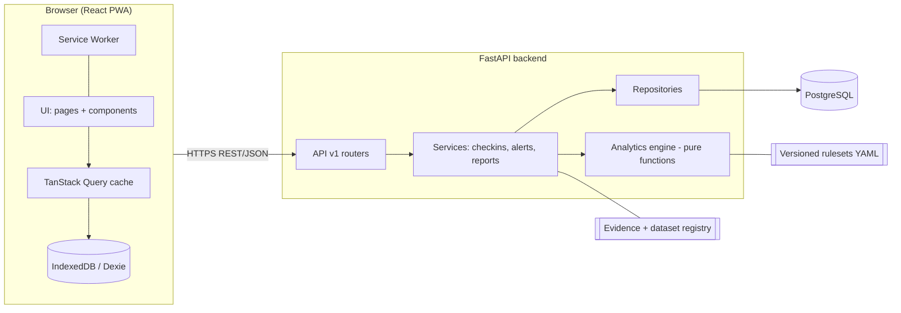
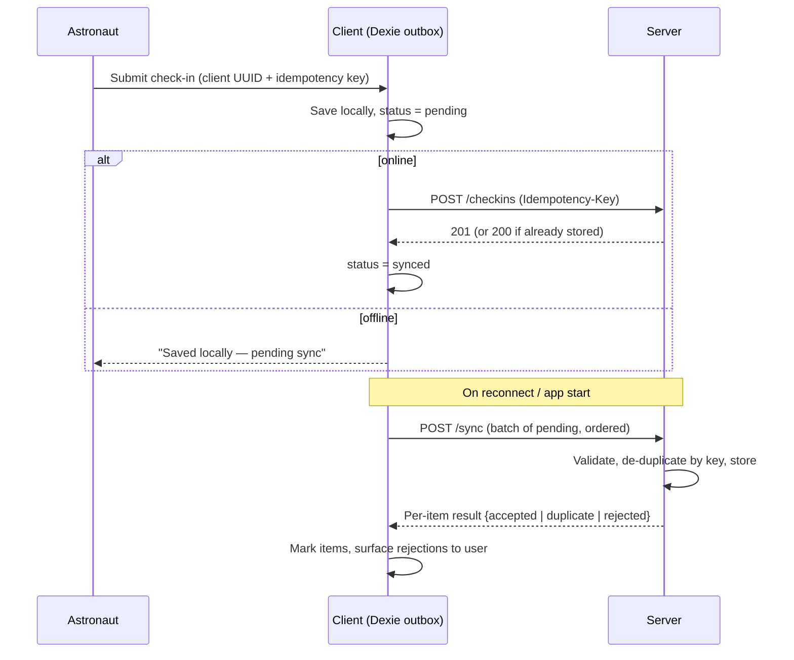

# AstraPulse — Technical Architecture & Stack

Version 1.0 · Team Interstellar · Companion to [PRD.md](PRD.md)

---

## 1. Architecture at a glance



**Key idea:** the analytics engine is a *pure, deterministic library* with no web or database imports. Services feed it data and persist its results. This makes it fully unit-testable and reproducible.

---

## 2. Technology stack

| Layer | Choice | Why |
|---|---|---|
| Frontend framework | React 19 + TypeScript (strict) | Typed UI, large ecosystem |
| Build tool | Vite | Fast dev server and builds |
| Styling | Tailwind CSS v4 (design tokens via `@theme`) | Consistent dark theme |
| Components | shadcn/ui (Radix primitives) | Accessible, unstyled-by-default |
| Routing | React Router | Standard SPA routing |
| Server state | TanStack Query | Caching, retries, offline awareness |
| Client state | Zustand (small UI state only) | Minimal boilerplate |
| Forms | React Hook Form + Zod | Typed validation, shared schemas |
| Charts | Recharts | Baseline bands, trend lines |
| PWA | vite-plugin-pwa (Workbox) | Service worker + manifest |
| Local storage | Dexie (IndexedDB) | Outbox queue, cached reads |
| Backend | Python 3.12 + FastAPI | Typed, async, OpenAPI for free |
| Validation | Pydantic v2 | Request/response schemas |
| ORM | SQLAlchemy 2.0 | Mature, typed |
| Migrations | Alembic | Schema versioning |
| Database | PostgreSQL 16 | Relational integrity, JSONB, partial indexes |
| Analytics | NumPy, Pandas; scikit-learn (optional) | Statistics; Isolation Forest stretch |
| Auth | argon2-cffi, PyJWT, httpOnly refresh cookie | Strong hashing, short-lived tokens |
| Rate limiting | slowapi | Login protection |
| Reports | ReportLab (PDF) + matplotlib (chart images) | No system-level dependencies |
| Config | pydantic-settings, `.env` | 12-factor |
| Logging | structlog (JSON) | Structured logs, request IDs |
| Backend tests | pytest, httpx, Hypothesis, factory helpers | Property tests for analytics |
| Frontend tests | Vitest, Testing Library, Playwright, axe | Unit, component, e2e, a11y |
| Quality | Ruff, mypy (analytics + services), ESLint, Prettier | Consistent code |
| Containers | Docker, Docker Compose | Reproducible environments |
| CI | GitHub Actions | Lint, test, build gates |
| Hosting (demo) | Frontend: Vercel/Netlify · API: Render/Fly.io · DB: Neon/Supabase Postgres | Free/low-cost tiers |

**Dependency policy:** pin versions in lockfiles; prefer well-maintained packages; no unmaintained libraries for security-sensitive code.

---

## 3. Repository structure

```
astrapulse/
├── CLAUDE.md                      # AI coding rules (also copy to .cursorrules)
├── README.md
├── docs/                          # PRD, TECH_STACK, ROADMAP, SUBMISSION, specs
├── frontend/
│   └── src/
│       ├── components/{common,dashboard,charts,alerts,wellness}/
│       ├── pages/
│       ├── hooks/
│       ├── services/              # api client, sync engine
│       ├── store/
│       ├── offline/               # Dexie schema, outbox, sync
│       ├── schemas/               # Zod schemas mirroring API
│       └── types/
├── backend/
│   ├── app/
│   │   ├── api/v1/                # routers (thin)
│   │   ├── core/                  # config, security, db, logging
│   │   ├── models/                # SQLAlchemy models
│   │   ├── schemas/               # Pydantic schemas
│   │   ├── services/              # business logic
│   │   ├── repositories/          # DB access
│   │   └── analytics/             # PURE engine (no FastAPI/SQLAlchemy imports)
│   │       ├── validation.py
│   │       ├── baseline.py
│   │       ├── deviation.py
│   │       ├── trends.py
│   │       ├── rules.py
│   │       ├── explain.py
│   │       └── rulesets/demo_v1.yaml
│   ├── alembic/
│   ├── scripts/                   # seed + synthetic data generator
│   └── tests/
├── data/{sample,nasa_references,processed}/
└── infra/{docker-compose.yml,Dockerfile.backend,Dockerfile.frontend}
```

**Layering rules:** routers → services → repositories → models. Routers never touch the DB directly. `analytics/` never imports from anywhere else in `app/`.

---

## 4. Backend design

### 4.1 Request flow (check-in)
1. Router validates payload via Pydantic.
2. Service checks authz (owner), idempotency key, and plausibility bounds.
3. Repository inserts `daily_checkin` + `observations` in one transaction.
4. Service triggers `analytics.evaluate(crew_id, as_of)`.
5. Engine returns structured results; service upserts baselines and alerts (idempotent by `(crew_id, rule_id, window_end)`).
6. Audit event written; response returns saved records + new alert IDs.

### 4.2 Analytics engine contract
```python
def evaluate(
    observations: Sequence[Observation],
    ruleset: Ruleset,
    as_of: datetime,
) -> EvaluationResult: ...
```
- No I/O, no clock calls (time is passed in), no randomness.
- Output includes baselines, per-metric states, triggered rules, evidence observation IDs, and explanation template inputs.
- Full algorithms: [ANALYTICS_SPEC.md](ANALYTICS_SPEC.md).

### 4.3 Authentication & authorisation
- Login → short-lived access token (≈15 min) in memory; refresh token in `httpOnly`, `Secure`, `SameSite=Strict` cookie, rotated on use.
- Argon2id for passwords.
- Every route declares required roles via a dependency; ownership/grant checks live in services.

**RBAC matrix**
| Resource | Astronaut | Specialist | Admin |
|---|---|---|---|
| Own check-ins / observations | R/W | — | — |
| Other crew observations | — | R (granted crew only) | R (audit purpose) |
| Journal entries | R/W own | R only if entry shared | — |
| Alerts (own) | R, review, comment | R, comment | R |
| Alerts (granted crew) | — | R, comment | R |
| Access grants | Create/revoke own | Request | Manage |
| Rulesets / seed | — | — | Manage |
| Audit log | — | — | R |

### 4.4 Error format
RFC 7807 `application/problem+json`: `type`, `title`, `status`, `detail`, `instance`, plus `errors[]` for field-level validation. Never leak stack traces or health values in error text.

### 4.5 Observability
- JSON logs with `request_id`, `user_id` (hashed), route, latency, status. **Never log observation values or journal text.**
- `/api/v1/system/health` (liveness) and `/ready` (DB check).

---

## 5. Database design (summary)

Full definitions in [DATA_DICTIONARY.md](DATA_DICTIONARY.md).

**Design decisions (ADR summary)**
| # | Decision | Reason |
|---|---|---|
| ADR-1 | Unified `observations` table (one row per metric value) instead of separate wide vital/radiation tables | Uniform provenance, baselines and analytics per metric; easy to add metrics |
| ADR-2 | Append-only observations with `amends_id` | Auditability; corrections without data loss |
| ADR-3 | `value` is nullable; `status` distinguishes `valid`, `missing`, `rejected` | Missing ≠ zero |
| ADR-4 | Timestamps stored UTC; `observed_at` and `recorded_at` separate | Back-fill and offline entries |
| ADR-5 | Rulesets are versioned files; the version string is stored on each alert | Reproducible explanations |
| ADR-6 | Alerts unique by `(crew_id, rule_id, window_end)` | Idempotent analytics runs |
| ADR-7 | Journal content stored separately with `visibility` and consent grants | Privacy by default |

---

## 6. Frontend design

### 6.1 Design tokens
| Token | Hex | Use |
|---|---|---|
| graphite | `#101820` | App background |
| navy | `#142B45` | Panels, sidebar |
| telemetry | `#38BDF8` | Primary accent, links, chart lines |
| signal | `#A3E635` | Nominal / success |
| alert | `#FB923C` | Watch / attention |
| review | `#F87171` | Review required (use with icon + text, never colour alone) |

### 6.2 Navigation
Dashboard · Daily Check-in · Health Analytics · Alert Center · Wellness Center · Mission Reports · Research & Evidence · Settings & Profile (+ Specialist Console for specialist role).

### 6.3 Core UI components
`MetricCard` (value, unit, source badge, timestamp, delta) · `TrendChart` (series + baseline band + alert markers) · `AlertCard` (what/why/baseline/latest/follow-up) · `ProvenanceBadge` · `SyncStatus` · `SimulatedBanner` · `EmptyState` / `NotRecorded` · `ConsentToggle`.

### 6.4 UI rules
- Missing → "Not recorded", greyed, with last-known timestamp.
- Colour is never the only signal (icons + text).
- Every chart has a data-table alternative.
- Copy follows [SAFETY_AND_LIMITATIONS.md](SAFETY_AND_LIMITATIONS.md).

---

## 7. Offline-first and sync design



**Rules**
- Client generates UUIDv4 `client_id` per check-in and per observation.
- Server treats `(user_id, client_id)` as unique; replays return the original result.
- Observations are immutable → no merge conflicts; edits are amendments.
- Outbox survives reloads (IndexedDB) and retries with exponential back-off.
- Rejected items remain visible with the reason; nothing is silently dropped.
- Cached reads: last 30 days of observations/alerts for offline viewing.
- Local data protection: no secrets in IndexedDB; sign-out clears cache; optional Web Crypto encryption of journal drafts.

---

## 8. Security checklist
- Secrets only in environment variables; `.env.example` committed, `.env` ignored.
- CORS restricted to known origins.
- Security headers (CSP, `X-Content-Type-Options`, `Referrer-Policy`, `Permissions-Policy`).
- Parameterised queries via ORM only; no string-built SQL.
- Request size limits; file-import size/type validation.
- Dependency scanning (`pip-audit`, `npm audit`) in CI.
- Account lockout back-off and login rate limits.
- Audit log immutable from application code (insert-only role/grants where supported).
- Backups: documented; demo DB is disposable.

---

## 9. Environments and deployment

| Environment | Purpose | Notes |
|---|---|---|
| local | Development | `docker compose up db`; Vite + uvicorn run natively |
| ci | Automated tests | Ephemeral Postgres service container |
| demo | Judges' live link | Seeded with synthetic ARES-01 data; reset script available |

Deployment steps live in [ROADMAP.md](ROADMAP.md) Phase 10. Always keep a **recorded demo video** as fallback in case of hosting or network failure.

---

## 10. Optional AI layer (AstraPulse Explain, P3)
- **Input:** structured alert JSON only (metric, baseline, latest, deviation, persistence, rule, evidence titles). No journal text, no identifiers.
- **Output:** 2–3 plain sentences. Validated: must not contain diagnosis/prescription vocabulary (denylist test) and must reference only provided numbers.
- **Fallback:** deterministic template text is always generated first and shown if the LLM is unavailable or fails validation.
- **Privacy:** use a local/open model or a provider with a no-retention agreement; synthetic data only in the demo.
